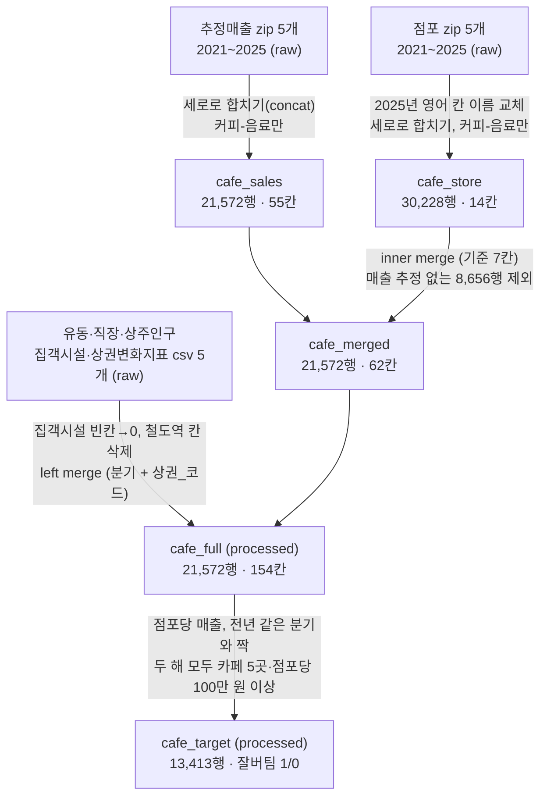

# 카페 포화 시대, 내년에도 서울 평균보다 잘 버틸 상권 예측

## 데이터 준비 과정

| 단계 | 처리 | 이유 | 검증 |
|---|---|---|---|
| 1. 추정매출 합치기 | 5개 파일 세로로 합침, 커피-음료만 | 연도별로 나뉜 파일을 하나로 | 행 수 합 일치(439,141행), 55칸, 분기 20개 → 21,572행 |
| 2. 점포 합치기 | 2025년 영어 칸 이름을 2024년 한글 이름으로 교체 후 합침, 커피-음료만 | 칸 이름이 다르면 다른 칸으로 붙음 | 칸 수·순서·값 비교 후 교체, 14칸, 분기 20개 → 30,228행 |
| 2-1. 누락 확인 | 점포에만 있는 8,656행 원인 확인 | 매출 없는 행을 뺄지 판단 | 누락 행의 77.8%가 카페 0~3곳 (매출 있는 행은 8.0%) |
| 3. 매출 + 점포 | inner merge, 기준 7칸 (분기·상권·업종 + 이름표 4칸) | 점포당 매출은 매출이 있어야 계산 가능 | 이름표 4칸 값 일치 확인, 21,572행, 62칸 |
| 4-1. 집객시설 정리 | 빈칸 → 0, 철도_역_수 삭제 | 파일에 0이 한 번도 없음 → 빈칸 = 시설 0개 | 최솟값 1, 0 개수 0 확인 |
| 4-2. 인구·시설 붙이기 | left merge, 기준 2칸 (분기 + 상권_코드) | 상권 이름이 파일마다 달라서 이름표 제외 | 행 수 그대로, 154칸, 중복 0, 짝 없는 행 최대 1.5%(집객시설)는 빈칸 유지 |
| 5. 점검·점포당 매출 | 아파트_가구_수 제외, 점포당 매출 = 매출 ÷ 유사_업종_점포_수 | 아파트 가구 수는 모든 값이 0, 카페 수는 프랜차이즈 포함 | 분모 0 없음, 점포당 매출 100만 원 미만 1,059행 확인 |
| 5-1. 전년 같은 분기와 짝 | 작년 값의 연도에 1을 더해 올해 행과 짝 맞춤 (inner) | 같은 분기끼리 비교해서 계절 차이 제거 | 16,745행 (2021년은 비교 대상이 없어 제외) |
| 5-2. 걸러 냄 | 두 해 모두 카페 5곳 이상, 점포당 분기 매출 100만 원 이상 | 작은 상권 출렁임, 매출 추정 실패 행 제외 | 13,413행, 연도별 약 3,300행씩 고르게 남음 |
| 5-3. 예측 대상 | 변화율이 같은 분기 중앙값보다 높으면 1 (잘버팀) | 같은 분기 상권끼리 비교해서 코로나·물가 영향 상쇄 | 1과 0이 반반 (6,702 / 6,711) |

1~4단계는 `notebooks/1.0-data-merge.ipynb`, 5단계는 `notebooks/2.0-eda.ipynb`에 있음

**알아둘 것**
- 2026년 1분기: 인구·시설 파일에만 있고 매출·점포에는 없음
- 카페 수 칸은 `유사_업종_점포_수`(일반 + 프랜차이즈) 사용. `점포_수`는 프랜차이즈를 빼고 셈